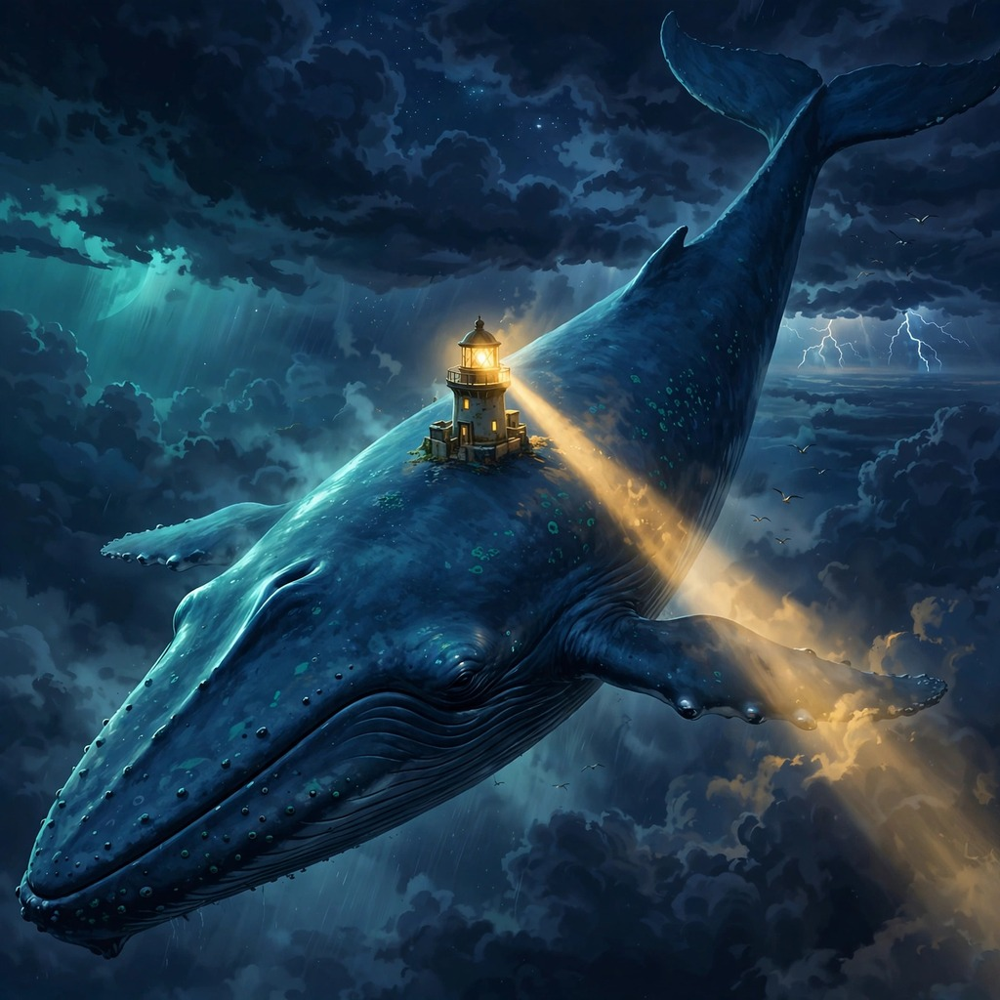

# Leviathan's Lantern

[](https://make.fun/bounty/ai-excited-01?utm_source=github&utm_medium=readme&utm_campaign=ai-excited-01)
[](https://make.fun/bounty/ai-excited-01/leaderboard?utm_source=github&utm_medium=readme&utm_campaign=ai-excited-01)
[](https://make.fun/bounty/ai-excited-01?utm_source=github&utm_medium=readme&utm_campaign=ai-excited-01)

## The idea

A blue whale the size of a storm cloud swims through the night sky — and
on its back stands a lighthouse, small as a candle, its beam the brightest
thing in the frame. The whale is the sky now; the lighthouse is the only
thing that still knows which way is up.

One look gives you the scale twice: the whale is impossibly huge, and the
lighthouse is impossibly small, and both are true at once. Lightning on
the horizon, seabirds for scale, a golden shaft of light cutting the dark
diagonal of the whale's body. It is the kind of image that stops a scroll.

## The artwork



`entry.png` — JPEG bytes under the `.png` name (the bounty allows either
format), 1024×1024, 205,313 bytes, under the 1 MiB limit.

## How the program works

`main.ts` is a dependency-free Node 22 program. It reads the bundled
artwork, walks its JPEG markers to confirm the file is whole (SOI at the
start, EOI at the end, a frame header with sides ≤ 1024), checks the size
and the SHA-256 of the bytes, then writes those exact bytes to the output
directory and reads them back to confirm they match byte for byte. No
timestamps, no randomness, no network — two runs write identical output.

## Run

```sh
mkdir -p out && MAKEFUN_OUTPUT_DIR=out node main.ts
```

This writes `out/entry.png`. Without `MAKEFUN_OUTPUT_DIR` the output
goes to `/output/entry.png`.

## License

MIT — see [LICENSE](LICENSE).

---

Built for the make.fun bounty [ai-excited-01](https://make.fun/bounty/ai-excited-01).
Try make.fun yourself: https://make.fun/?ref=77v1ce78
